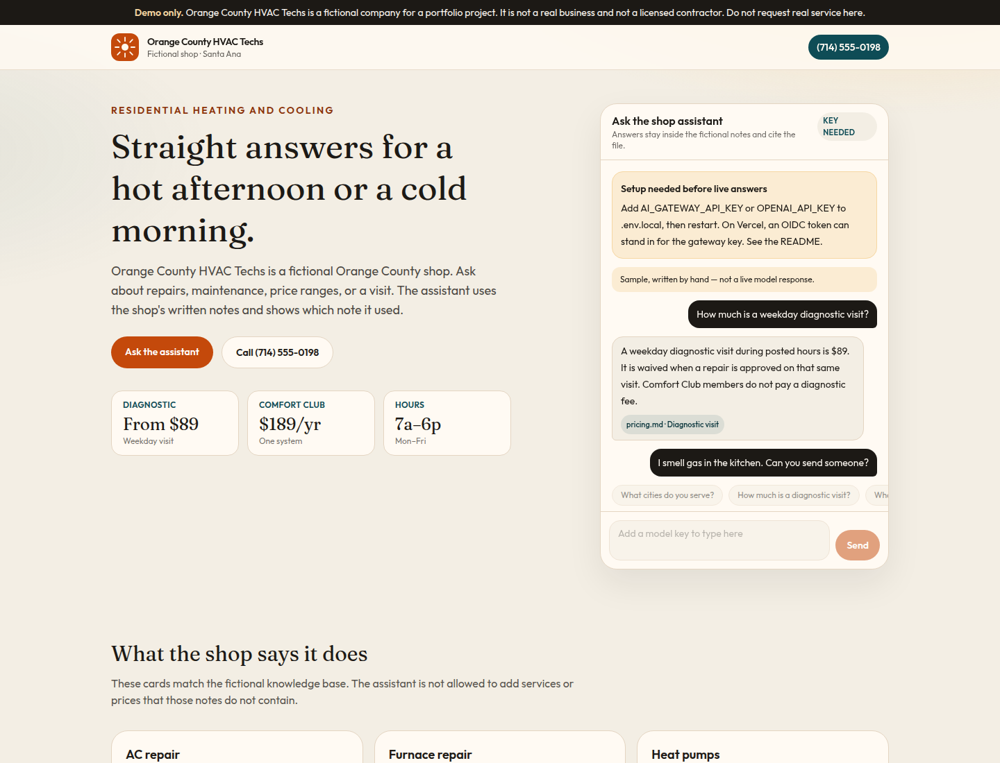
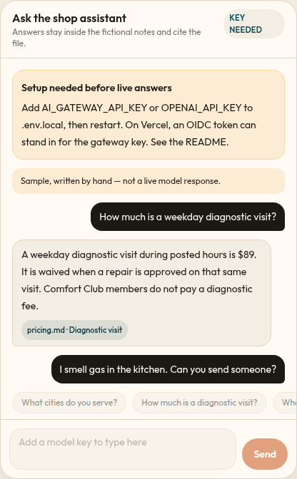
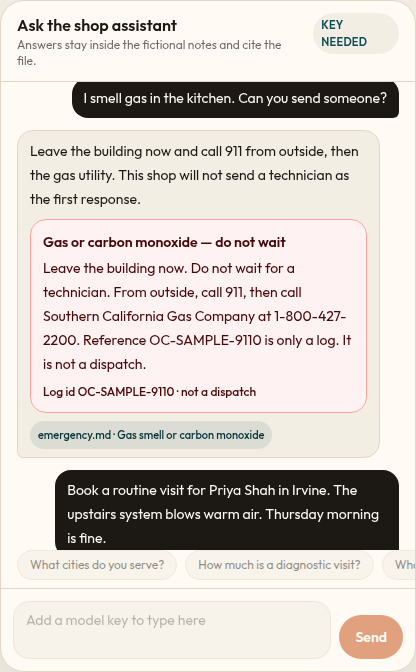
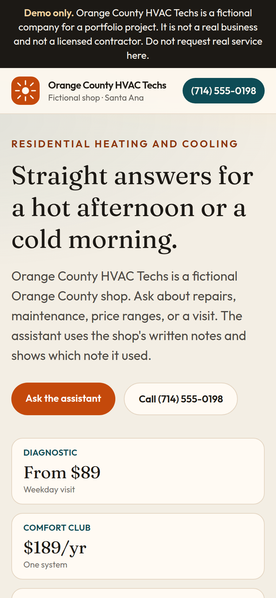
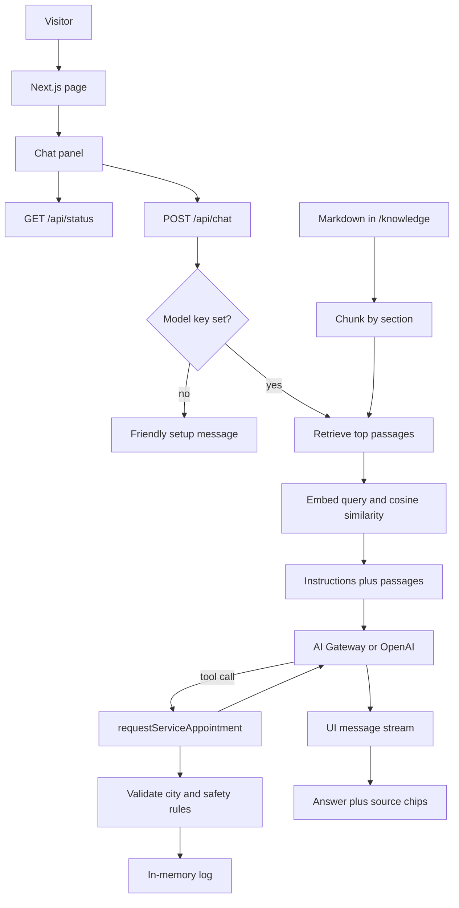

# Orange County HVAC Techs — fictional AI assistant

**Demo only.** Orange County HVAC Techs is not a real business, not a licensed contractor, and not affiliated with any HVAC company. The address, the `555` phone number, the license number, the prices, and the financing partner are invented for this portfolio project. Do not request real service.

Prija Cash built this to show the shape of a production AI feature: a grounded customer assistant, source citations, and one real action (requesting a visit), without a pile of infrastructure.

## Problem

A homeowner with a warm house, a maintenance question, or a scary smell does not want a generic chatbot. They want the shop's actual prices, hours, and safety rules, and a way to ask for a visit. A model on its own will invent a price and might tell someone to wait inside for a technician when they smell gas.

This demo keeps the shop's policies in markdown, retrieves the relevant passages for each question, and only lets the model answer from those passages. Booking goes through a tool that checks the city and the safety rules in code, not only in the prompt.

## Demo

These shots are from a production build **without** a model key. Live answers stay behind the setup message. A labeled sample conversation shows a cited price, the gas-safety card, and the start of a booking.









Replace the images after you run the app with a key if you want a shot of a live answer. Keep the "fictional / demo" banner in anything you publish.

## Architecture



The page itself is static. Only the chat and status routes run on each request, so a missing key cannot crash the marketing page.

## How retrieval works

1. On each question the server loads `/knowledge/*.md` and splits it on `##` headings. Long sections split again on paragraphs, around 1,600 characters.
2. If a gateway or OpenAI key is configured, each chunk is embedded once per server instance and cached in memory. The question is embedded with the same model, and the top passages are chosen with cosine similarity (`cosineSimilarity` from the AI SDK). A very low top score is marked as a weak match so the prompt prefers "I don't know."
3. If embeddings fail, or no key is configured, the same chunks are ranked with a small keyword overlap score. The UI labels that fallback as a keyword match. The eval script uses this path so it can run without a key.
4. The passages are inserted into the instructions with their filename and section title. The model is told to answer only from them, to copy prices as written ranges, and to end with `Sources: file.md`. The UI does not trust that line alone: the retrieved passages are also attached as message metadata and rendered as source chips.

There is no vector database. That is deliberate. A few dozen short policy chunks do not need one, and a JSON or memory index is easy to explain in an interview.

## How the booking tool works

The model has one tool, `requestServiceAppointment`. It may call the tool only after it has a name, city, issue, preferred time, and urgency (`routine`, `soon`, or `emergency`).

The tool does not trust the model:

- The city has to match the list in `knowledge/service-area.md` (plus HB, RSM, and MV).
- Name, issue, and preferred time are checked for length and shape.
- **Gas smell, rotten egg, carbon monoxide:** the tool returns `emergency-redirect`, tells the person to leave and call 911 and Southern California Gas Company at 1-800-427-2200, and stores a log id that is **not** a dispatch.
- **No heat or no cooling in a heat wave, freezing weather, or with an infant, elderly person, or medical sensitivity** (or when urgency is `emergency` and the issue is no heat or no cooling): the visit is logged as an emergency, with the after-hours `$149` trip charge called out.
- Anything else that validates is logged as a normal request with an id like `OC-20261127-A1B2`.

Requests are kept in memory for the life of the server process and appended to `data/appointments.jsonl` when the disk is writable, otherwise `/tmp`. On Vercel each instance has its own memory, and the deployment filesystem is not a database. That limit is called out below.

## Setup

Requirements: Node.js 22 or newer.

```bash
npm install
cp .env.example .env.local
# edit .env.local — set one key
npm run dev
```

Open [http://localhost:3000](http://localhost:3000).

Without a key the page still loads. The assistant explains how to add one and shows a sample conversation. It does not throw.

### Environment variables

| Variable | Required | Purpose |
| --- | --- | --- |
| `AI_GATEWAY_API_KEY` | One of these auth options | Vercel AI Gateway. Preferred for local scripts and for deploys that are not using OIDC. |
| `VERCEL_OIDC_TOKEN` | One of these auth options | Present on Vercel deployments, and locally after `vercel env pull`. The AI SDK uses it when no gateway key is set. |
| `OPENAI_API_KEY` | One of these auth options | Direct OpenAI, used only when no gateway key and no OIDC token are set. |
| `AI_MODEL` | No | Chat model. Default `openai/gpt-5.4-mini`. Gateway ids look like `provider/model`. Direct OpenAI strips a leading `openai/`. |
| `EMBEDDING_MODEL` | No | Retrieval model. Default `openai/text-embedding-3-small`. |

Confirm model ids against the live catalog before you lock one in. It changes:

```bash
curl -fsSL https://ai-gateway.vercel.sh/v1/models
```

`openai/gpt-5.4-mini` is the default because the catalog lists it with tool calling, and a mini model keeps a demo cheap. `openai/text-embedding-3-small` is the default embedding model for the same reason. Override either one if you want a different provider.

On Vercel (`VERCEL=1`) the app attempts the gateway even before you paste a key, because OIDC can authenticate the request. If that call is rejected, the chat shows an error and you can set `AI_GATEWAY_API_KEY`.

## Scripts

```bash
npm run dev        # local app
npm run lint       # eslint
npm run typecheck  # tsc --noEmit
npm run build      # production build
npm run eval       # retrieval, booking rules, and live answers when a key exists
```

### Eval

`scripts/eval.ts` checks eleven questions. Without a key it still checks that each question retrieves the expected markdown file, that the prompt demands citations, and that the booking function confirms an Irvine visit, rejects Riverside, refuses to dispatch on a gas smell, and flags a heat-wave no-cooling call. With `AI_GATEWAY_API_KEY` or `OPENAI_API_KEY` set, it also generates an answer per question and fails if the answer does not name the source file or misses the expected fact (for example `$89`, `911`, or "we do not install solar").

```bash
npm run eval
```

## Deploy on Vercel

The app is a standard Next.js App Router project. No extra build image and no database.

1. Push the repository and import it on Vercel. Framework preset: Next.js.
2. In the project, open AI Gateway (or set `AI_GATEWAY_API_KEY` / `OPENAI_API_KEY` and `AI_MODEL` in the project environment).
3. Deploy. The marketing page is static. `POST /api/chat` and `GET /api/status` run on each request and read env at request time, so a key added later does not require a code change beyond a redeploy if you change the variables.
4. The knowledge markdown is included in the server trace via `outputFileTracingIncludes` in `next.config.ts`.

Do not put real customer data in this demo. Appointment logs are not durable.

## Design decisions

**Retrieval instead of fine-tuning.** Prices, cities, and warranty terms change by editing a markdown file. Fine-tuning would bake yesterday's price into weights, would not show a source, and would cost more to refresh. Retrieval keeps the source of truth in git and lets the UI cite it.

**Guardrails in two places.** The prompt says: use only the passages, do not invent a price or a rebate, stay on this shop's HVAC topics, and say you do not know. The booking tool repeats the dangerous rules in code, because a prompt can be talked out of a 911 instruction and a gas leak must not become a confirmed visit. Prices in the UI cards are the same figures as `knowledge/pricing.md`. The model is told to copy ranges, not collapse `$180–$850` into one number.

**Cost.** One mini chat model, one small embedding model, five passages per question, and embeddings cached on the instance. There is no reranker, no second model call to grade the answer, and no always-on vector store. The tradeoff is that a cold start embeds the corpus once, and a paraphrased question can miss when the keyword fallback is all you have.

**What I would do next**

- Store appointment requests in a real database and show them to the office, with a phone number collected on purpose.
- Record the eval's model answers as fixtures so CI can catch citation regressions without spending a credit every run.
- Add a reranker or a stricter "abstain" threshold once real transcripts show which questions the embeddings confuse.
- Rate-limit `/api/chat` and redact logs before this is anything but a demo.
- Hand off to a person when the tool returns `needs-info` twice, instead of looping.
- Highlight the exact sentence inside the cited chunk, not only the filename.

## Project layout

```
app/api/chat/route.ts     streaming agent route
app/api/status/route.ts   whether a model key is configured
knowledge/                fictional shop documents
lib/knowledge/            chunking, city list, retrieval
lib/appointments/         validation, safety rules, tool
lib/ai/                   model selection and instructions
scripts/eval.ts           the checks above
```
